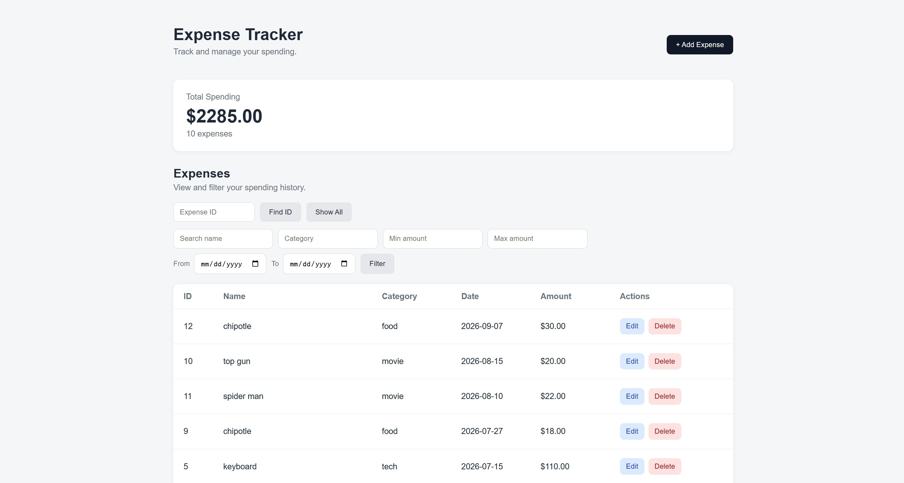

# Expense Tracker

The fourth version of a personal expense tracker. Built with FastAPI, SQLite, and a simple browser frontend. The API lets users create, view, search, update, replace, and delete expenses, while SQLite keeps the data saved after the server stops. The frontend is plain HTML, CSS, and JavaScript that talks to the API.

## Screenshot



## Features

- Add new expenses with a name, amount, category, and date
- Edit an existing expense from the browser
- View all expenses, or filter them by name, category, amount range, and date range
- Name search matches part of a name and ignores upper/lower case, and category matching ignores case
- Look up a single expense by its ID
- See the total spent and the number of expenses for the current filter
- Delete an expense
- Store expenses in a SQLite database, newest expense date first
- Validate empty inputs, positive amounts, date formatting, and ranges (min can't be above max, start can't be after end)

## Tech Stack

- **Python** – main language
- **FastAPI** – the web framework for the API
- **Uvicorn** – the server that runs the API
- **Pydantic** – validates the expense data
- **SQLite** – stores expenses in a local database file
- **HTML, CSS, JavaScript** – the browser frontend, no frameworks

## Project Structure

```
Expense-Tracker/
├── backend/
│   ├── main.py
│   ├── database.py
│   └── models.py
├── frontend/
│   ├── index.html
│   ├── app.js
│   └── style.css
├── images/
│   └── screenshot.jpg
├── requirements.txt
├── README.md
└── .gitignore
```

## API Routes

| Method | Endpoint | Description |
|---|---|---|
| GET | `/` | Check that the API is running |
| GET | `/expenses` | View all expenses |
| GET | `/expenses` with optional query parameters | Search by `name`, `category`, `min_amount`, `max_amount`, `start_date`, and `end_date` |
| GET | `/expenses/summary` | Total spent and expense count, takes the same filters as `/expenses` |
| GET | `/expenses/{expense_id}` | View one expense by ID |
| POST | `/expenses` | Add a new expense |
| PATCH | `/expenses/{expense_id}` | Update one or more fields of an expense |
| PUT | `/expenses/{expense_id}` | Fully replace an expense |
| DELETE | `/expenses/{expense_id}` | Delete an expense |

## Setup

Get the project onto your machine and install what it needs. You only do this once.

```bash
git clone https://github.com/henryravanesi-tech/Expense-Tracker.git
cd Expense-Tracker

# (optional) create and activate a virtual environment
python -m venv .venv

# Mac/Linux
source .venv/bin/activate

# Windows
.venv\Scripts\activate

pip install -r requirements.txt
```

## Usage

The project has two parts: the API server and the frontend. Each one runs in its own terminal, so start the API first and then the frontend.

**1. Start the API server:**

```bash
cd backend
uvicorn main:app --reload
```

The API runs at `http://127.0.0.1:8000`. You can also open `http://127.0.0.1:8000/docs` in your browser to see FastAPI's documentation. The SQLite database file (`expenses.db`) is created automatically in the folder you start the server from, so always start it from `backend`.

**2. Start the frontend:**

In a second terminal:

```bash
cd frontend
python -m http.server 5500 --bind 127.0.0.1
```

Then open `http://127.0.0.1:5500/` in your browser. The API only allows requests from `127.0.0.1:5500` and `localhost:5500`, so keep that port. If you use the VS Code Live Server extension instead, it uses the same port.

## Notes

This is V4 of the project. Expenses are stored in a SQLite file, so the data is saved even after the server restarts.

In version 4, the terminal client was replaced with a browser frontend. The frontend can add, edit, delete, search, and filter expenses, including by date range, and shows the total for whatever is currently filtered. On the backend, a `/expenses/summary` route was added, name search became a partial case-insensitive match, results are sorted by date, and the amount and date range checks moved to the API so any client gets the same error messages. The project was also split into `backend` and `frontend` folders.

The main goal of V4 was to make the tracker usable without the terminal while keeping the frontend small and simple.
